# מדריך למשתמש: ספרי בר אילן באוצריא

המדריך מסביר איך להתקין את התוסף, איך משתמשים בו, ומה עושים כשמשהו לא עובד. אין צורך בידע טכני.

> **שתי מילים שתראו בתוסף:**
> - **"שירות"** הוא רכיב קטן שהמתקין מתקין במחשב, בשם "שירות בר אילן לאוצריא". הוא מה שמדבר עם תוכנת בר אילן.
> - **"רשימת הספרים"** היא הרשימה שהתוסף קורא פעם אחת מבר אילן, כדי שתוכלו לחפש בה.

---

## מה התוסף עושה

אם במחשב שלכם מותקנת התוכנה **פרויקט השו"ת של בר אילן**, התוסף מאפשר:

- **לחפש** את ספרי בר אילן מתוך אוצריא, לפי שם הספר או שם המחבר, ולפתוח אותם בבר אילן בלחיצה אחת;
- **לראות** לכל ספר את המחבר, מקום ההדפסה ושנת ההדפסה, ובלחיצה גם את המהדורה ואת מקומו בבר אילן;
- **לחפש בטקסט של כל ספרי בר אילן, עם כל אפשרויות החיפוש של בר אילן:** חיפוש רגיל בשדה אחד, חיפוש מתקדם (צורות, מילים חלופיות, מרחקים, באותו משפט או פסקה), או שאלה במילים שלכם — גם בקטגוריות מסוימות בלבד, בלי לזכור אף סימן;
- **לפתוח מקום מדויק:** כותבים "בראשית ב ג", ובר אילן נפתח ישר בפסוק;
- **לחפש בבר אילן טקסט מספר פתוח באוצריא:** מסמנים משפט, לוחצים לחיצה ימנית ובוחרים "חיפוש בבר אילן";
- **לפתוח בבר אילן את המקום שקוראים באוצריא:** לחיצה ימנית בספר ← "איתור המקום בבר אילן";
- **לחפש בבר אילן מדיאלוג החיפוש של אוצריא**, בסימון התיבה "חיפוש בבר אילן במקום באוצריא";
- **למצוא ספרי בר אילן גם במסך הספרייה של אוצריא**, בתיבה "איתור ספר או מחבר";
- **לעבוד בעברית או באנגלית**, לפי שפת אוצריא או לפי בחירה;
- **להתאים את התצוגה:** גופן מגופני אוצריא, וגודל מ-90% עד 150% במחוון;
- **לעבוד בלי אינטרנט:** הכול קורה במחשב שלכם.

**הלשוניות של התוסף:** **ספרים** (חיפוש ועיון), **חיפוש בטקסט**, **איתור מקום**, **הגדרות**, **עזרה** ו**אודות ודיווח**. הכפתור **"פתיחת בר אילן"** בראש הלשונית פותח את התוכנה, או מביא אותה לחזית. בחלון צר הלשוניות עוברות לסרגל בתחתית. מספר פתוח באוצריא מגיעים ללשוניות גם במקלדת (ראו "קיצורי מקלדת").

בר אילן **לא חייב להיות פתוח**: כשצריך, התוסף פותח אותו לבד. אם הוא כבר פתוח, גם ממוזער, התוסף משתמש בו ומעלה אותו לחזית. מי שמעדיף לפתוח אותו בעצמו מכבה בהגדרות את "הפעלת בר אילן כשהוא סגור".

**מה התוסף לא עושה:**
- הוא לא מעתיק את תוכן הספרים לאוצריא. הספר נפתח בתוכנת בר אילן עצמה.
- הוא לא שולח מידע מהמחשב החוצה, חוץ מדיווח על בעיה שאתם בוחרים לשלוח (ואוצריא מבקשת אישור לפניו). הוא לא צריך אינטרנט כדי לעבוד.

---

## הבהרה חשובה

- **התוסף נועד למי שרכש כדין רישיון** לתוכנת פרויקט השו"ת של אוניברסיטת בר אילן. הוא עובד רק עם התוכנה שמותקנת אצלכם, ואינו מעתיק, שומר או שולח את תוכן הספרים.
- **אין להשתמש בו עם עותק שאינו מורשה.** "שארית ישראל לא יעשו עוולה" (צפניה ג, יג).
- **התוסף אינו מוצר רשמי של אוניברסיטת בר אילן** ואינו קשור אליה. כל הזכויות על התוכנה ועל תכניה שמורות לבעליהן.

ההבהרה מופיעה גם בתוסף עצמו: בפתיחה הראשונה, וב"אודות". פרטים נוספים ב[פורום אוצריא](https://otzaria.org/forum/post/42068).

---

## מה צריך

- מחשב עם **Windows 10 ומעלה** (64 ביט);
- **אוצריא** מותקנת (גרסה 0.9.98 ומעלה. לאוצריא 0.9.97 מתאימה גרסה 0.4 של התוסף);
- **פרויקט השו"ת של בר אילן** מותקן, בכל מהדורה, ברישיון.

---

## התקנה (פעם אחת, כשתי דקות)

### שלב 1: הורדת המתקין

1. **הורדה ישירה של הגרסה האחרונה:** <https://github.com/mmichaelush/otzaria-responsa-plugin/releases/latest/download/OtzariaResponsa-Setup.exe>
   - הקישור קבוע: הוא מוריד תמיד את המתקין העדכני.
   - או מדף ההורדות (<https://github.com/mmichaelush/otzaria-responsa-plugin/releases/latest>), בחלק **Assets**: הקובץ **`OtzariaResponsa-Setup.exe`** (או `OtzariaResponsa-Setup-<גרסה>.exe`, אותו קובץ). לא הקובץ שמסתיים ב-`.otzplugin`, ולא "Source code".
2. **אם הדפדפן כותב שהקובץ "אינו מוריד בדרך כלל":** לחצו על שלוש הנקודות שליד ההודעה ← **"שמור"** ← **"שמור בכל זאת"**.
3. **אם ההורדה לא מתחילה בכלל:** ייתכן שהסינון חוסם את האתר. אפשר לבקש את הקובץ ב[פורום אוצריא](https://otzaria.org/forum).
4. **אין אינטרנט במחשב הזה?** הורידו את המתקין במחשב אחר, והעבירו אותו בדיסק און קי. **המתקין כולל גם את התוסף לאוצריא**, ולכן אין צורך בחנות התוספים. אחרי ההתקנה אין צורך באינטרנט.

> **התוסף כבר מותקן באוצריא** ומציג "צריך להתקין רכיב קטן"? אפשר ללחוץ שם על **"הורדת המתקין"**. זה אותו קובץ.

### שלב 2: הפעלת המתקין

1. פתחו את הקובץ שירד. בדרך כלל הוא בתיקיית "הורדות".
2. ייתכן שתופיע הודעה כחולה: **"Windows הגן על המחשב שלך"**.
   - זה קורה כי המתקין חדש ועדיין לא מוכר ל-Windows.
   - לחצו על **"מידע נוסף"**, ואז על **"הפעל בכל זאת"**.
3. במסך הפתיחה לחצו **"הבא"**.

   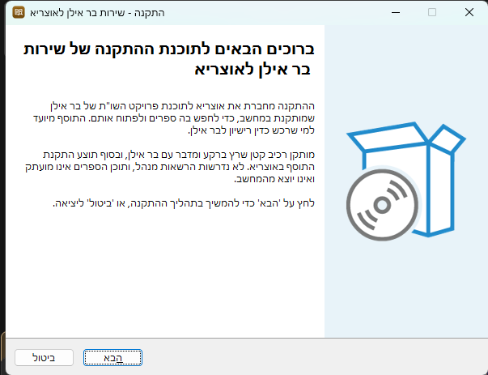

4. ההתקנה לוקחת כמה שניות. **לא נדרשות הרשאות מנהל.**
5. במסך הסיום השאירו את הסימון **"להתקין את התוסף באוצריא (מומלץ)"** ולחצו **"סיום"**.
   - **בעדכון** כתוב שם **"לעדכן את התוסף באוצריא לגרסה… (מומלץ)"**.
   - **אין סימון, וכתוב שהתוסף כבר מותקן ומעודכן?** אין צורך בשלב 3. לחצו "סיום".

   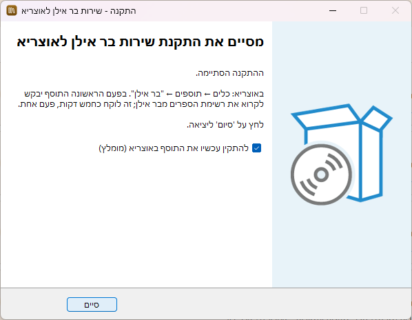

### שלב 3: אישור באוצריא

1. אוצריא נפתחת ומציגה את החלון **"התקנת תוסף: בר אילן"**.
2. בחלק **"הרשאות נדרשות"** יש כמה מתגים:
   - **הדליקו את "הוספת רכיבים לתוכנה".** אוצריא מציגה אותה כבויה, ובלעדיה אין "חיפוש בבר אילן" בלחיצה ימנית, אין קיצור מקלדת ואין ספרי בר אילן במסך הספרייה. היא לא מריצה שום דבר ברקע.
   - **את כל השאר השאירו כמו שהם.** מה שדלוק דלוק בכוונה:
     - **"גישה לשירותים מקומיים"**: בלעדיה התוסף לא יכול לדבר עם הרכיב שהתקנתם. היא **לא** פותחת גישה לאינטרנט.
     - **"פתיחת קישורים בדפדפן"**: כדי שהכפתורים "הורדת המתקין" ו"מדריך למשתמש" יעבדו.
     - **"פריטים בתפריט הטקסט"** ו**"קיצורי מקלדת"**: בשביל "חיפוש בבר אילן" ו"איתור המקום בבר אילן" בלחיצה ימנית, ובשביל הקיצורים (`Ctrl+Alt+B` ועוד).
     - **"תוכן ספרים"**: כדי ש"איתור המקום בבר אילן" ימצא את הכותרת של השורה שסימנתם, מתוכן העניינים של הספר באוצריא. בלעדיה נלקח המקום של השורה הראשונה במסך.
     - **"רכיבים בחלון החיפוש"**: בשביל התיבה "חיפוש בבר אילן במקום באוצריא".
     - **"ספרים בחיפוש הספרייה"**: בשביל ספרי בר אילן בתיבה "איתור ספר או מחבר".
     - **"ניווט במסכים"**: כדי שקיצור מקלדת יוכל לפתוח את לשונית בר אילן.
     - **"יצירת קיצור דרך"**: בשביל הכפתור שיוצר קיצור בשולחן העבודה. אוצריא שואלת לפני שהיא יוצרת.
   - **שכחתם?** אפשר להדליק כל הרשאה גם אחר כך: הגדרות אוצריא ← **כלים** ← "בר אילן". התוסף עצמו יזכיר לכם בהודעה מעל שורת החיפוש.
3. לחצו **"התקן"**.

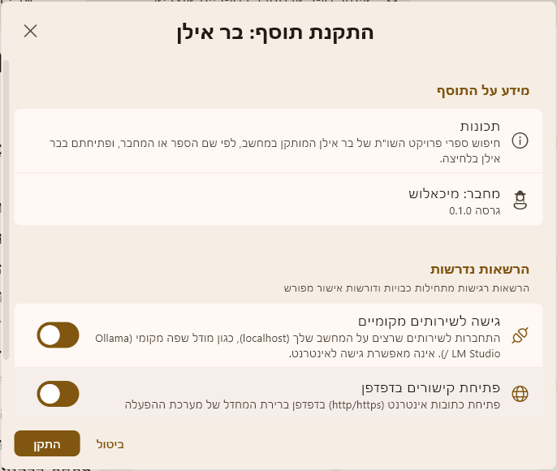

זהו. ההתקנה הסתיימה.

---

## הפעם הראשונה

### מסך הפתיחה

1. באוצריא, בסרגל שבצד ימין של החלון, לחצו על **"כלים"** (מתחת ל"חיפוש"). ובחלק **"תוספים"** לחצו על **"בר אילן"**: הסמל של **ספר פתוח עם זכוכית מגדלת**.

   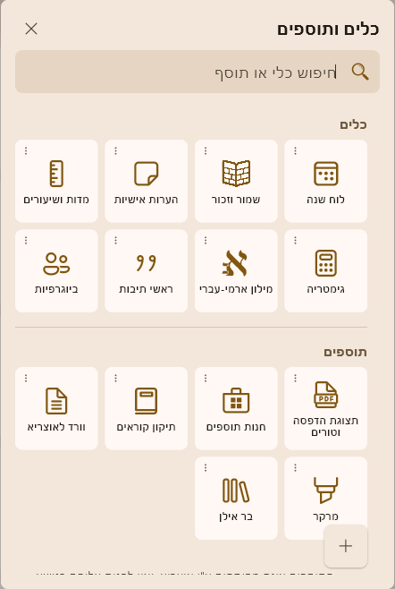

2. בפעם הראשונה נפתח המסך **"ברוכים הבאים לבר אילן באוצריא"**. יש בו, לפי הסדר:
   - **הבהרה חשובה** על רישיון בר אילן (ראו למעלה);
   - מה התוסף עושה;
   - **"מה צריך כדי להתחיל":** רשימה שמראה מה כבר **מוכן** ומה **חסר**:
     - תוכנת פרויקט השו"ת של בר אילן מותקנת במחשב;
     - "שירות בר אילן לאוצריא" מותקן ופועל;
     - ההרשאה "הוספת רכיבים לתוכנה" דלוקה;
     - רשימת הספרים נקראה מבר אילן.
3. לחצו **"הבנתי, בואו נתחיל"**. מה שחסר מוסבר בלשונית עצמה, צעד אחר צעד. **"איך משתמשים"** פותח את ההדרכה שבתוך התוסף.

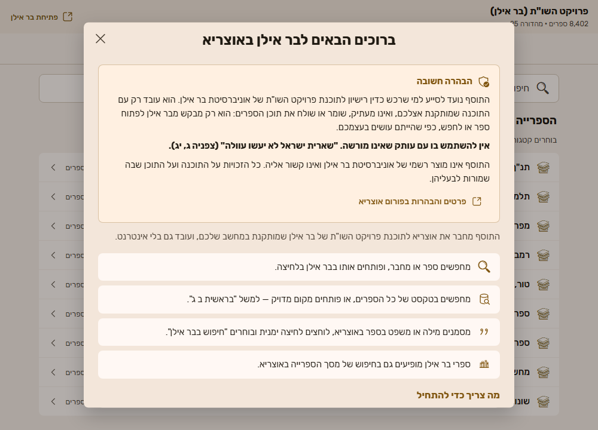

המסך לא יופיע שוב מעצמו. אפשר לחזור אליו מהלשונית **"אודות ודיווח"** ← **"מסך הפתיחה"**.

### קריאת רשימת הספרים (כמה דקות, פעם אחת)

1. אחרי מסך הפתיחה יופיע המסך **"הכנה חד-פעמית"**. לחצו **"התחלה"**.

   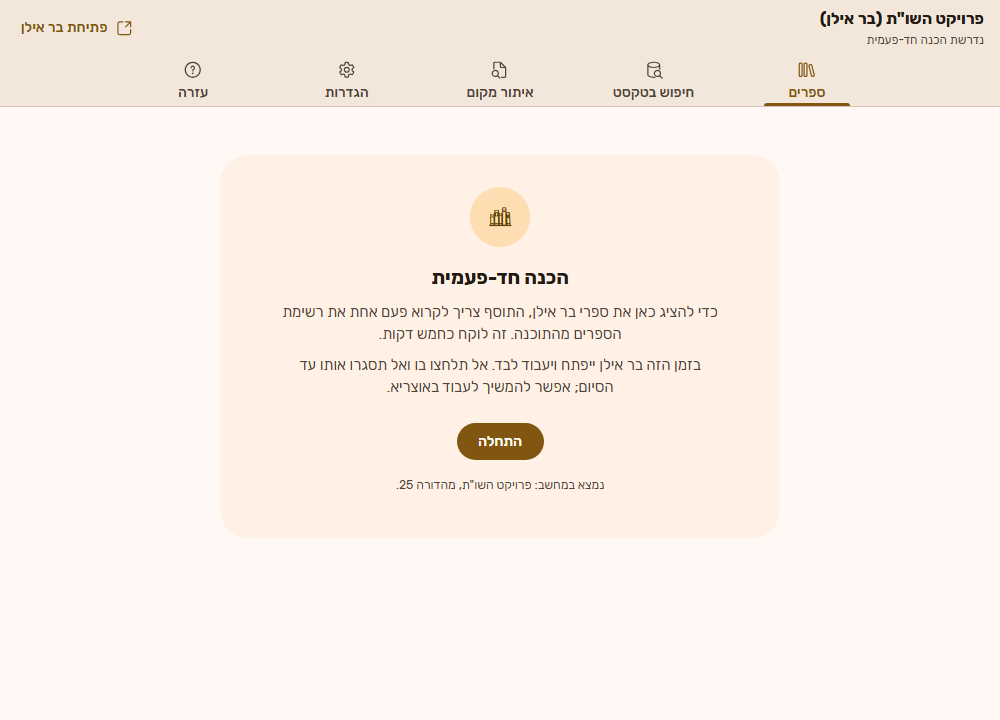

2. **בר אילן ייפתח לבד ויעבוד לבד.**
   - אל תלחצו בו ואל תסגרו אותו עד שהקריאה תסתיים. ספרים פתוחים בבר אילן כדאי לסגור לפני ההתחלה.
   - המחשב לא ייכנס למצב שינה מחוסר פעילות בזמן הקריאה, והמסך יישאר דלוק. אם בר אילן מפסיק להגיב לרגע, הקריאה מחכה לו (עד שלוש דקות) וממשיכה.
   - אפשר להמשיך לעבוד באוצריא בינתיים, וגם לסגור את לשונית התוסף. הקריאה ממשיכה.
   - רוצים לעצור? לחצו **"ביטול"**. אפשר להתחיל שוב מתי שתרצו.

   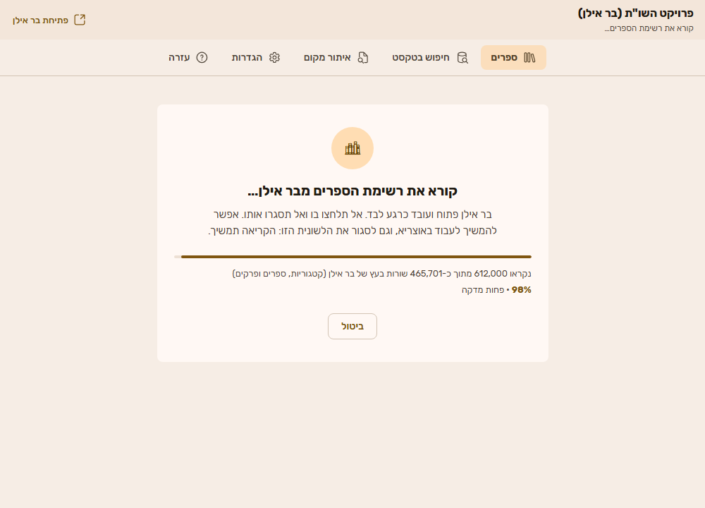

3. בסיום תופיע הודעה **"רשימת ספרי בר אילן מוכנה"**, ומסך החיפוש ייפתח.

---

## שימוש יומיומי

### חיפוש ספר

1. פתחו את התוסף: **כלים ← תוספים ← בר אילן**, ועברו ללשונית **"ספרים"**.
2. הקלידו בשורת החיפוש שם של ספר, שם של מחבר, או שניהם. התוצאות מופיעות תוך כדי הקלדה.

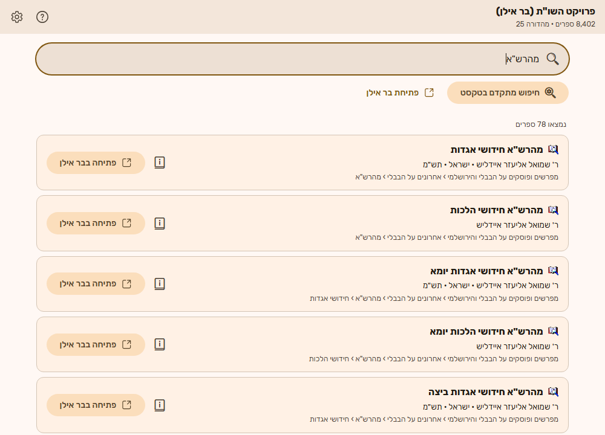

**טיפים לחיפוש:**
- **אפשר לכתוב בלי גרשיים:** `מהרשא` מוצא את `מהרש"א`.
- **כתיב מלא וחסר מוצאים אותו ספר:** `חדושי` מוצא גם `חידושי`.
- **אפשר לשלב מחבר ושם ספר:** `רא"ש יבמות`.
- **תואר לפני שם המחבר אינו מפריע:** `הרב עובדיה יוסף`, `הגאון רבי משה פיינשטיין`, `החיד"א`.
- **לא מצאתם?** נסו מילה אחת בלבד מהשם.
- **בכמה מהדורות של בר אילן אין במחשב רשימת מחברים** (למשל 32C). אז אפשר לחפש רק לפי שם הספר, והלשונית אומרת זאת.
- **לנקות את החיפוש:** מקש `Esc`.

**בחלון צר** (למשל כשאוצריא פתוחה בחצי מסך) הלשוניות עוברות לסרגל בתחתית, התוצאות מסתדרות לרוחב החלון, וכל הכפתורים נשארים זמינים.

### עיון בקטגוריות

כשתיבת החיפוש ריקה, הלשונית מציגה את **הספרייה של בר אילן**: הקטגוריות, ולצד כל אחת מספר הספרים שבה.

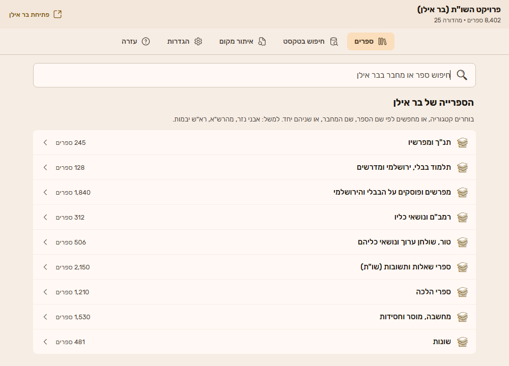

- **להיכנס לקטגוריה:** לוחצים עליה. בתוכה מופיעות תתי-הקטגוריות, ואחריהן הספרים שבה.
- **לחזור:** השורה שמעל השם מראה איפה אתם בעץ ("כל הספרים ‹ …"). לחיצה על כל רמה בה חוזרת אליה.
- **לחפש רק בקטגוריה:** כשאתם בתוך קטגוריה, תיבת החיפוש כותבת "חיפוש בתוך …", והחיפוש מוצא רק ספרים שבה ובמה שתחתיה. **"חיפוש בכל הספרים"** שליד מספר התוצאות יוצא מהקטגוריה ומחפש שוב בהכול.
- **בפעם הבאה** הלשונית נפתחת בקטגוריה האחרונה שבה הייתם.
- ליד שם כל ספר מופיע **הסמל של בר אילן**, מתוך התוכנה שמותקנת אצלכם.

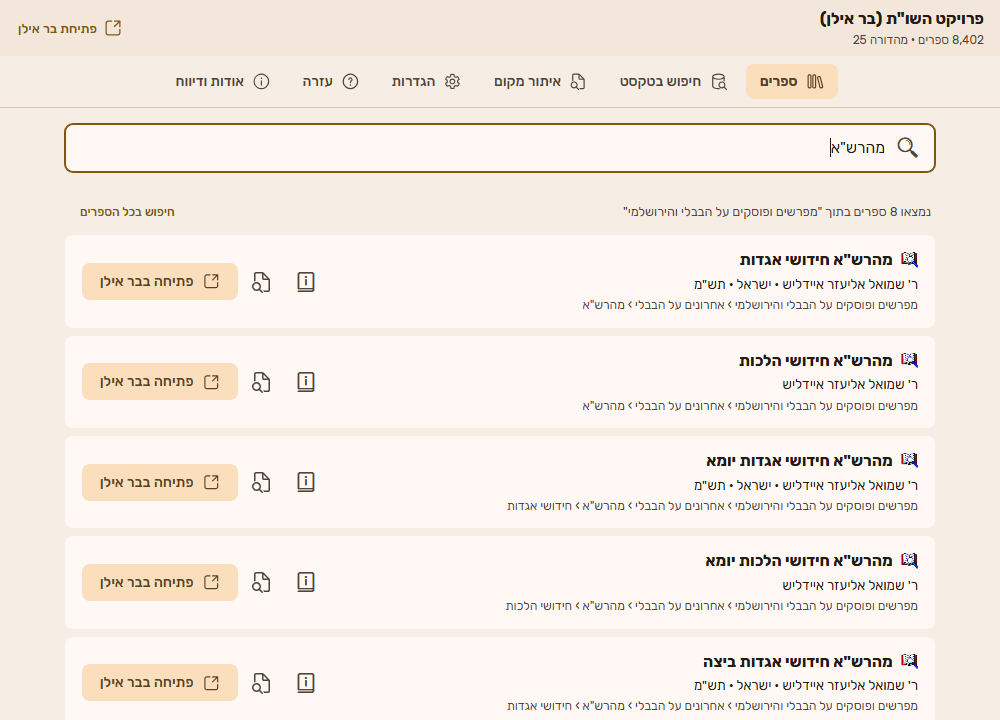

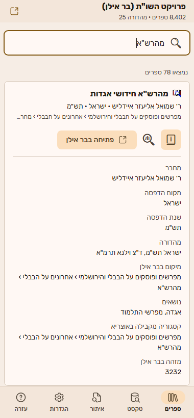

### פרטי הספר

ליד כל ספר יש כפתור קטן **"פרטי הספר"** (סמל של ספר עם האות i). לחיצה עליו פותחת מתחת לספר את כל מה שידוע עליו:

- מחבר, מקום הדפסה ושנת הדפסה;
- **מהדורה**: שורת המהדורה המלאה של בר אילן, כשיש בה יותר ממקום ושנה;
- **מיקום בבר אילן**: איפה הספר נמצא בעץ הספרים של בר אילן;
- נושאים, והקטגוריה המקבילה באוצריא, כשיש;
- **מזהה בבר אילן**: מספר הספר ברשימה. שימושי בפנייה לתמיכה.

לחיצה נוספת על הכפתור סוגרת את הפרטים. חיפוש חדש סוגר אותם לבד.

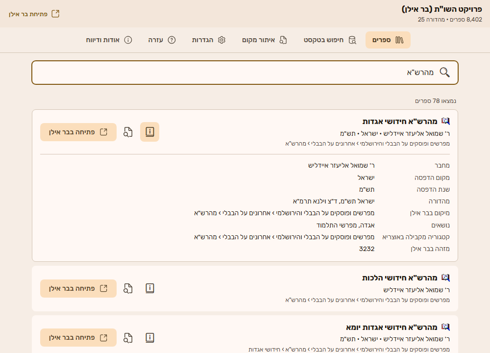

### פתיחת ספר

לחצו על **"פתיחה בבר אילן"** ליד הספר. בר אילן ייפתח (או יעלה לחזית אם הוא כבר פתוח), והספר יוצג בו.

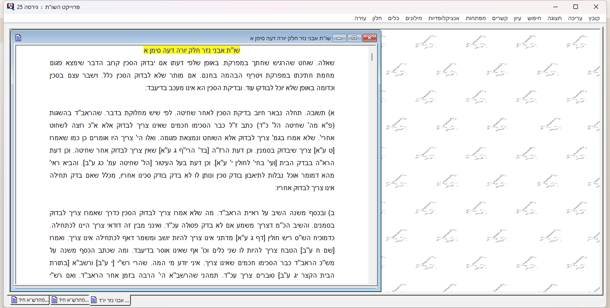

- **כמה זמן:** בדרך כלל שלוש שניות. אם בר אילן היה סגור, קצת יותר.
- **בזמן הפתיחה:** הכפתור מציג "פותח…". אי אפשר לפתוח ספר נוסף עד שהפתיחה מסתיימת.
- **אם הספר לא נפתח:** תופיע הודעה שמסבירה למה ומה אפשר לעשות. ראו גם "פתרון בעיות" בהמשך.
- **לפתוח במקום מסוים בספר:** הכפתור **"פתיחה במקום מסוים"** (סמל של זכוכית מגדלת על דף) שליד הספר עובר ללשונית "איתור מקום" עם שם הספר, ונשאר רק לכתוב את המקום.

### חיפוש טקסט בבר אילן, מתוך ספר פתוח באוצריא

1. פתחו ספר כלשהו באוצריא, וסמנו בעכבר מילה או משפט.
2. לחצו **לחיצה ימנית** על הטקסט המסומן, ובחרו **"חיפוש בבר אילן"**.
   - **במקום לחיצה ימנית** אפשר ללחוץ יחד על **Ctrl+Alt+B**.
3. בר אילן עולה לחזית ומציג את **תוצאות החיפוש בחלון שלו**, כאילו הקלדתם את החיפוש בבר אילן עצמו.
4. באוצריא מופיעה הודעה קטנה, למשל **"בר אילן מצא 2,543 תוצאות"**.

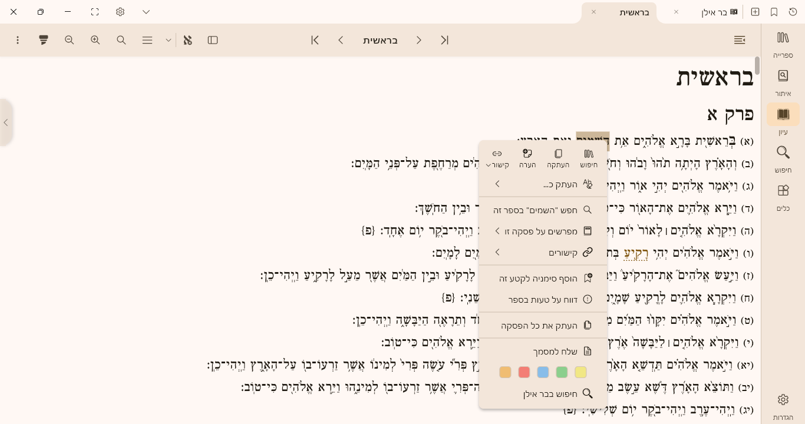

**כדאי לדעת:**
- **ניקוד, טעמים וסימני פיסוק מוסרים לבד** לפני החיפוש. גם ראשי תיבות עובדים: `רמב"ם`.
- **נשלחות עד עשר מילים.** אם סימנתם קטע ארוך, יחופשו עשר המילים הראשונות, ותופיע הודעה על כך.
- **בר אילן שואל "האם ברצונך לחפש בכל המאגרים?"**: זו שאלה של בר אילן עצמו, כי במאגרים שנבחרו בו לא נמצאו תוצאות. עונים עליה בחלון של בר אילן.
- **"נמצאו מעל 32000 תוצאות"**: החיפוש כללי מדי. סמנו קטע ארוך או מדויק יותר.
- **לא רוצים את הפריט בתפריט?** מכבים אותו בלשונית "הגדרות".
- **התוסף לא צריך לרוץ ברקע:** אוצריא פונה ישר לשירות, גם כשהלשונית סגורה. הפריט מופיע אחרי שלשונית "בר אילן" נפתחה פעם אחת והתחברה לשירות.

### איתור המקום בבר אילן, מתוך ספר פתוח באוצריא

לומדים באוצריא ורוצים לראות את אותו מקום בבר אילן, למשל כדי לעיין במפרשים שיש רק שם:

1. בספר הפתוח באוצריא, **סמנו מילה** בשורה שאת מקומה רוצים לפתוח, לחצו עליה **לחיצה ימנית**, ובחרו **"איתור המקום בבר אילן"**. בלי סימון, אוצריא אינה מציגה את הפריט.
2. לשונית **"איתור מקום"** נפתחת, ומקום השורה כבר כתוב בה, בצורה שבר אילן מכיר. למשל "ברכות, דף ב." נכתב "ברכות דף ב עמוד א".
3. **מקור אחד מתאים:** בר אילן נפתח ישר במקום הזה.
4. **כמה מקורות:** למשל הגמרא ומפרשיה על אותו דף. המקורות של הספר שפתוח באוצריא מופיעים ראשונים, בכתב מודגש. כשאחד מהם הוא בדיוק הספר הזה, הוא נפתח מיד, והרשימה נשארת כדי לבחור מקור אחר.

**כדאי לדעת:**
- **מקור שכתוב בספר:** כשמסמנים מקור שלם, למשל `(ב"מ לא, א)` או `שו"ע או"ח סי' רצט`, ובוחרים "איתור המקום בבר אילן", נפתח המקור שסומן ולא המקום שבו קוראים. אם בר אילן אינו מכיר את הטקסט שסומן, נפתח המקום שבו קוראים, כרגיל.
- **אם בר אילן אינו מכיר את המקום המדויק** (למשל סעיף), התוסף מנסה מקום כללי יותר (הסימן כולו).
- **אם בר אילן אינו מכיר את שם הספר,** מופיע הסבר, ובשדה נשאר המקום בצורתו הכללית ביותר. אפשר לתקן את שם הספר ולנסות שוב, או לחפש אותו בלשונית "ספרים".
- **המקום נלקח מתוכן העניינים** של הספר באוצריא, לפי השורה שסימנתם. אם ההרשאה "תוכן ספרים" כבויה, נלקח המקום של השורה הראשונה במסך.

### חיפוש בבר אילן מדיאלוג החיפוש של אוצריא

1. בדיאלוג החיפוש של אוצריא, פתחו את **"אפשרויות נוספות"** וסמנו את התיבה **"חיפוש בבר אילן במקום באוצריא"**. כשהיא מסומנת, אוצריא פותחת את "אפשרויות נוספות" מעצמה, כדי שהסימון לא יוסתר.
2. כתבו מילים ולחצו **"חפש"**. לשונית **"חיפוש בטקסט"** נפתחת עם המילים, ובר אילן מחפש אותן.

**כדאי לדעת:**
- **כשהתיבה מסומנת, אוצריא אינה מחפשת בעצמה.** הסימון נשמר גם לחיפושים הבאים, ולכן מבטלים אותו כשרוצים לחפש באוצריא שוב.
- **אפשרויות המילה עוברות לבר אילן:** אותיות שימוש (`#נר`), סיומות דקדוקיות (`נר#`), כתיב מלא/חסר (`!נר`, ועם אותיות שימוש `#!נר`), "התעלם מגרשיים" (`+רמבם`) ו"תרגום ארמי" (`^אמר`). מילים חלופיות עוברות כ-`(נר/אור)`, מרווח בין מילים כמרחק (גם מרווח שונה לכל זוג), ו"מילה אחת לפחות" כמילים חלופיות. "קידומות", "סיומות" ו"חלק ממילה" עוברות כ"כל אות" (`*`), שרחבה מהן. "ראשי תיבות" מדליק את "כולל ראשי תיבות" לכל החיפוש.
- **"באותה פסקה"** עובר כ"באותה פסקה" של בר אילן, ו**"תחת אותה כותרת"** כ"באותו מסמך" (פרק או סימן), בקירוב.
- **מה שאין לו מקבילה בבר אילן** (שגיאות כתיב, קידומות וסיומות ארמיות, ניקוד וטעמים, צירוף אפשרויות שבר אילן אינו מקבל, מילים לשלילה, סינון קטגוריות) אינו עובר במדויק. ההודעה אחרי החיפוש אומרת מה בדיוק לא עבר.
- **התחום הוא זה שבחור בלשונית "חיפוש בטקסט"**, ולא הסינון של אוצריא.
- התיבה אינה מופיעה בחיפוש מקורב. לא רוצים לראות אותה בכלל? מכבים את המתג בלשונית "הגדרות".

### קיצורי מקלדת

הקיצורים פעילים כשספר פתוח באוצריא (מסך העיון):

| קיצור | מה עושה |
|---|---|
| `Ctrl+Alt+B` | חיפוש הטקסט המסומן בבר אילן |
| `Ctrl+Alt+R` | לשונית "ספרים" |
| `Ctrl+Alt+T` | לשונית "חיפוש בטקסט" |
| `Ctrl+Alt+L` | לשונית "איתור מקום" |

אפשר לשנות כל קיצור, או להוסיף קיצור ל"פתיחת לשונית בר אילן", באוצריא: הגדרות ← קיצורי מקשים ← "קיצורי תוספים".

### חיפוש בטקסט

בלשונית **"חיפוש בטקסט"** מחפשים בטקסט של כל ספרי בר אילן. החיפוש רץ בבר אילן עצמו, והתוצאות נפתחות בחלון שלו, כאילו חיפשתם שם. בראש הלשונית בוחרים אחד משלושה סוגי חיפוש, ומתחתיו מופיע הסבר קצר: מה הסוג הזה עושה ומתי הוא מתאים.

#### איזה סוג חיפוש לבחור?

| מה רוצים למצוא | איך | לדוגמה |
|---|---|---|
| ביטוי, שם, או כמה מילים שמופיעות יחד | **חיפוש רגיל** | `נר חנוכה` |
| אותן מילים, גם עם אותיות שימוש ("בנר חנוכה") או עם מילה ביניהן ("נר ראשון של חנוכה") | **חיפוש רגיל** ← "עם תוספות" | `נר חנוכה` |
| מילים שמופיעות קרוב זו לזו, אבל לא צמודות | **חיפוש מתקדם**, ובין המילים "עד כמה מילים אחריה" | "נר", ועד 4 מילים אחריו "שבת" |
| כמה מילים באותו משפט, באותה פסקה או באותה תשובה | **חיפוש מתקדם** ← "איפה המילים צריכות להופיע" | "מעלית" ו"שבת" באותה פסקה |
| אחת מכמה מילים | **חיפוש מתקדם** ← "או מילה אחרת" | "עץ", או "אילן", או "נטיעה" |
| ביטוי שנכתב גם בקיצור | **חיפוש מתקדם**: הביטוי, ו"או מילה אחרת" לקיצור | "צער בעלי חיים" או "צעב"ח" |
| מילה בכל צורותיה (שומר, שמירה, ישמור) | **חיפוש מתקדם** ← "כל המילים מאותו שורש" | `שמר` |
| מקורות בלי מילה מסוימת | **חיפוש מתקדם** ← "בלי המילה הזו" | "ישראל" בלי "בני ישראל" |
| נושא או שאלה, כשלא יודעים באילו מילים המקור משתמש | **ניסוח חופשי** | `האם יש חיוב לתרום כליה לחולה מסוכן` |
| רק בספרים או בקטגוריות מסוימים | בכל הסוגים: **"איפה לחפש"** | רק "שו"ת אחרונים" |

**בכל סוג חיפוש יש "נסו:"** עם דוגמאות מוכנות. לחיצה על דוגמה ממלאת אותה, ומשם אפשר לשנות. ולפני שלוחצים "חיפוש בבר אילן", **"מה יחופש"** מסביר במילים פשוטות בדיוק מה יחופש.

#### חיפוש רגיל

ברירת המחדל, והכי פשוט: כותבים מילים ולוחצים **"חיפוש בבר אילן"** (או Enter). בר אילן מחפש אותן ב"חיפוש קל" שלו.

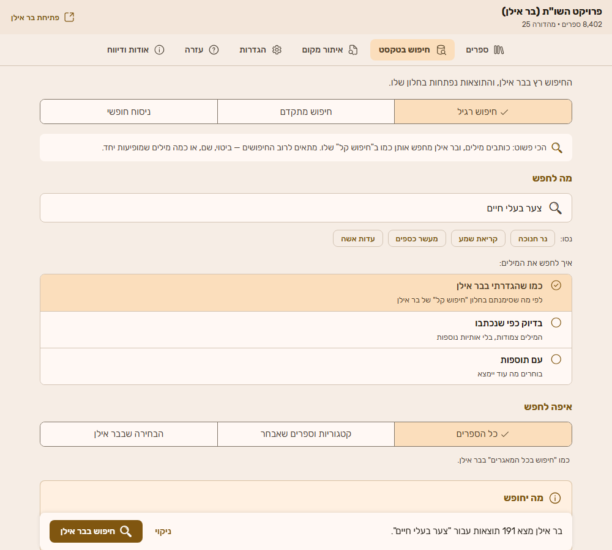

**איך לחפש את המילים** (מתחת לשדה):

- **כמו שהגדרתי בבר אילן** (ברירת המחדל): לפי מה שסימנתם בחלון "חיפוש קל" של בר אילן עצמו. כך החיפוש בתוסף מוצא מה שהחיפוש שלכם בבר אילן מוצא.
- **בדיוק כפי שנכתבו:** המילים צמודות, בסדר שנכתבו, בלי אותיות נוספות.
- **עם תוספות**, ובוחרים אילו:
  - **אותיות שימוש לפני המילה הראשונה** (ו, ה, ב, כ, ל, מ, ש): "נר חנוכה" ימצא גם "בנר חנוכה";
  - **עד שתי מילים בין המילים:** "נר חנוכה" ימצא גם "נר ראשון של חנוכה";
  - **כתיב מלא או חסר:** "חנוכה" ימצא גם "חנכה".

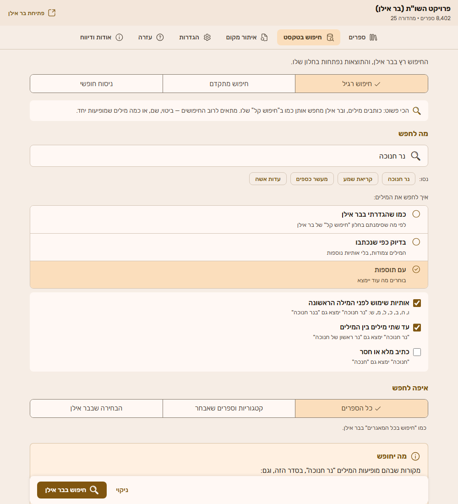

**כמה זה משנה?** כך נמצא "נר שבת" בכל ספרי בר אילן 25:

| איך לחפש | תוצאות |
|---|---|
| בדיוק כפי שנכתבו | 2,568 |
| עם אותיות שימוש בלבד | 3,864 |
| עם עד שתי מילים ביניהן בלבד | 4,598 |
| עם אותיות שימוש ועם עד שתי מילים ביניהן | 7,201 |

**ההגדרות שבבר אילן אינן משתנות:** אחרי החיפוש הן חוזרות למה שסימנתם שם. ("איך לחפש את המילים" מופיע עם שירות 0.6.0 ומעלה. עם שירות 0.5.6 או 0.5.7 החיפוש הוא לפי ההגדרות שבבר אילן, ועם שירות ישן יותר המילים מחופשות צמודות.)

#### חיפוש מתקדם

כשצריך לדייק. כל האפשרויות של "חיפוש מתקדם" ושל "חיפוש טבלאי" בבר אילן, בלי לזכור אף סימן. עוברים אליו בכפתור **"חיפוש מתקדם"** שבראש הלשונית; המילים שכבר נכתבו בחיפוש הרגיל עוברות אליו.

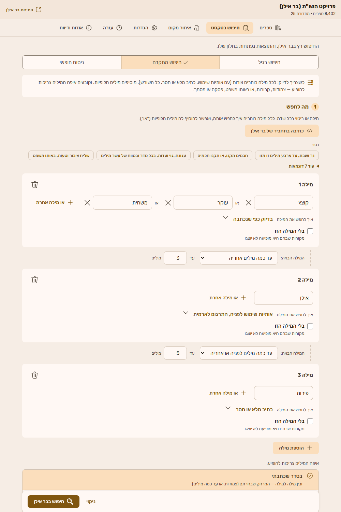

**צעד אחר צעד:**

1. **כותבים מילה בשדה "מילה 1".** אפשר גם **ביטוי** של כמה מילים, למשל "צער בעלי חיים": הוא יחופש בדיוק כמו שנכתב.
2. **בוחרים "איך לחפש את המילה"** (בטבלה שלמטה).
3. **"או מילה אחרת"** מוסיף **חלופה**: מספיק שאחת מהן תופיע. למשל "קוצץ", או "עוקר", או "משחית". גם חלופה יכולה להיות ביטוי, למשל "צער בעלי חיים" או "צעב"ח".
4. **"הוספת מילה"** מוסיף את המילה הבאה. בין מילה למילה בוחרים מרחק: **מיד אחריה**, **עד כמה מילים אחריה**, או **עד כמה מילים לפניה או אחריה**.
5. **"בלי המילה הזו"** מוציא מקורות שבהם המילה מופיעה. למשל "ישראל", בלי "בני" שלפניה.
6. **"איפה המילים צריכות להופיע"** (כשיש יותר ממילה אחת):
   - **בסדר שכתבתי**, במרחקים שבחרתם בין המילים (ברירת המחדל);
   - **בכל סדר, קרובות זו לזו:** כל המילים, בטווח של מספר מילים שבוחרים;
   - **באותו משפט**, **באותה פסקה** (הלכה, סעיף או דיבור המתחיל) או **באותו מסמך** (פרק, סימן או תשובה): בכל סדר ובכל מרחק, ובלבד שכולן שם.

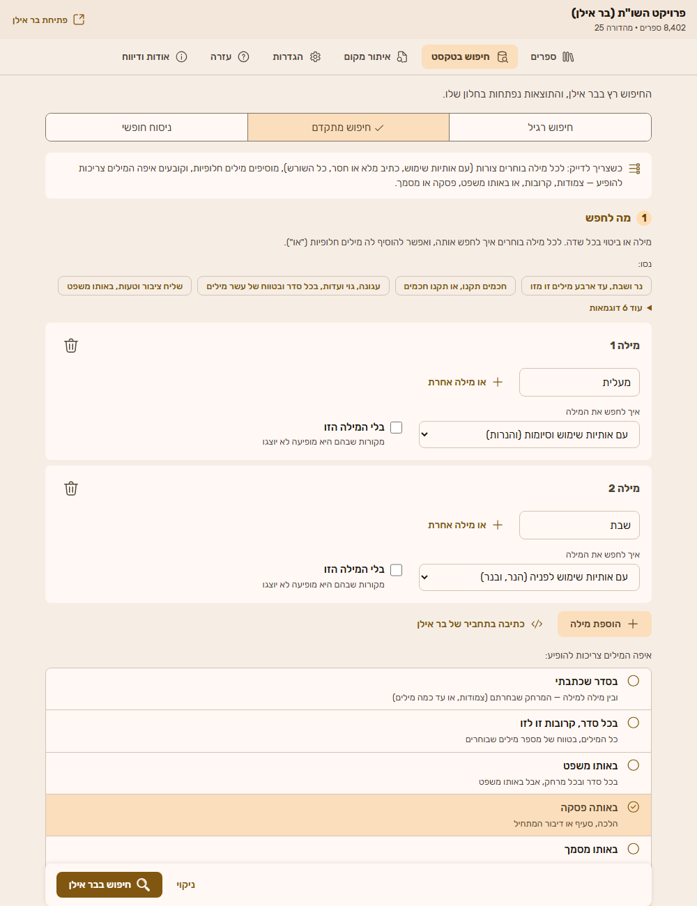

**איך לחפש את המילה:**

| בוחרים | מוצא | בתחביר של בר אילן |
|---|---|---|
| בדיוק כפי שנכתבה | רק "נר" | `נר` |
| עם אותיות שימוש לפניה | גם "הנר", "ובנר" | `#נר` |
| עם סיומות | גם "נרות", "נרו" | `נר#` |
| עם אותיות שימוש וסיומות | גם "והנרות" | `#נר#` |
| מילה שמתחילה כך / מסתיימת כך / מכילה את האותיות | כל מילה כזו | `נר*`, `*נר`, `*נר*` |
| בכתיב מלא או חסר | "אהרון" וגם "אהרן" | `!אהרון` |
| עם או בלי גרשיים | "רמב"ם" וגם "רמבם" | `+רמבם` |
| כל צורות הערך המילוני | "מדרגה", "ממדרגתו" | `$מדרגה` |
| כל המילים מאותו שורש | "שומר", "שמירה", "ישמור" | `%שמר` |
| כולל התרגום לארמית | גם המילה בארמית | `^אמר` |
| משפחת מילים / חיפוש שמור שהגדרתם בבר אילן | כמו שהגדרתם שם | `<שם>`, `{שם}` |

**דוגמאות** (ב"נסו:" שבראש החיפוש המתקדם; לחיצה טוענת אותן):

- **"נר" ועד ארבע מילים אחריו "שבת":** `נר [1:4] שבת`
- **"חכמים תקנו", או "תקנו חכמים":** `חכמים [-1:1] תקנו`
- **"עגונה", "גוי" ו"עדות", בכל סדר, עד עשר מילים זו מזו:** `10: עגונה גוי עדות`
- **"שליח ציבור" ו"טעה" (כל השורש), באותו משפט:** `משפט: #שליח ציבור %טעה`
- **"מעלית" ו"שבת", באותה פסקה:** `פסקה: #מעלית# #שבת`
- **"צער בעלי חיים", או בקיצור "צעב"ח":** `({{צער בעלי חיים}}/צעב"ח)`
- **השחתת עצים:** `(קוצץ/עוקר/משחית) [1:3] (עץ/אילן/נטיעה)`
- **"אהרון הכהן", בכתיב מלא או חסר ועם אותיות שימוש:** `#!אהרון הכהן`
- **"טלפון" בכל צורות הכתיב (טליפון, טעלעפאן):** `*ט*ל*פ*ן*`
- **"ישראל", בלי "בני ישראל":** `-בני ישראל`

**כדאי לדעת:**

- **"מה יחופש"** מסביר כל חיפוש במילים, ומתחתיו מוצגת השאילתה בתחביר של בר אילן. אפשר להעתיק אותה ולהדביק בבר אילן עצמו.
- **מכירים את התחביר?** **"כתיבה בתחביר של בר אילן"** פותח שדה לכתיבה ביד. "חזרה לבונה החיפוש" חוזר. **"סימני החיפוש של בר אילן"** בתחתית הלשונית מסביר כל סימן.
- **שגיאה בשאילתה** מוצגת בהסבר של בר אילן עצמו, למשל "אין משפחה בשם זה".
- **ביטוי של כמה מילים** מחופש כמו שנכתב, ולכן "איך לחפש את המילה" שלו הוא "בדיוק כפי שנכתבה". לצורות אחרות כותבים מילה בכל שדה.
- **"באותה פסקה" ו"באותו מסמך" מוצאים הרבה.** כשבר אילן משיב שנמצאו יותר מדי תוצאות, מצמצמים: מילה מדויקת יותר, "באותו משפט", או קטגוריות מסוימות.

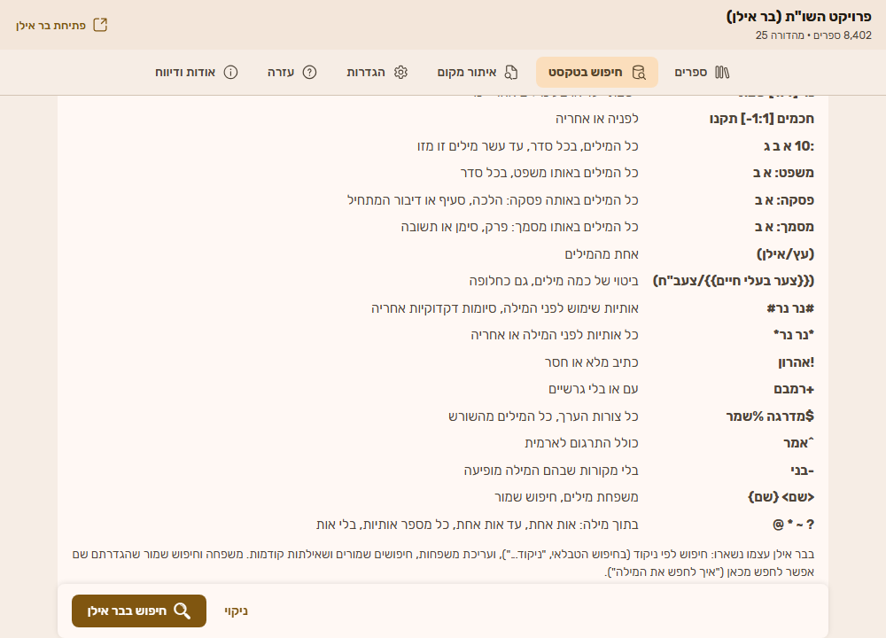

#### ניסוח חופשי

לא בטוחים באילו מילים המקור משתמש? בוחרים **"ניסוח חופשי"** וכותבים שאלה או נושא במילים שלכם. בר אילן מחפש מקורות שעוסקים בזה, גם כשהמילים בהם אחרות. זה "חיפוש בניסוח חופשי" של בר אילן.

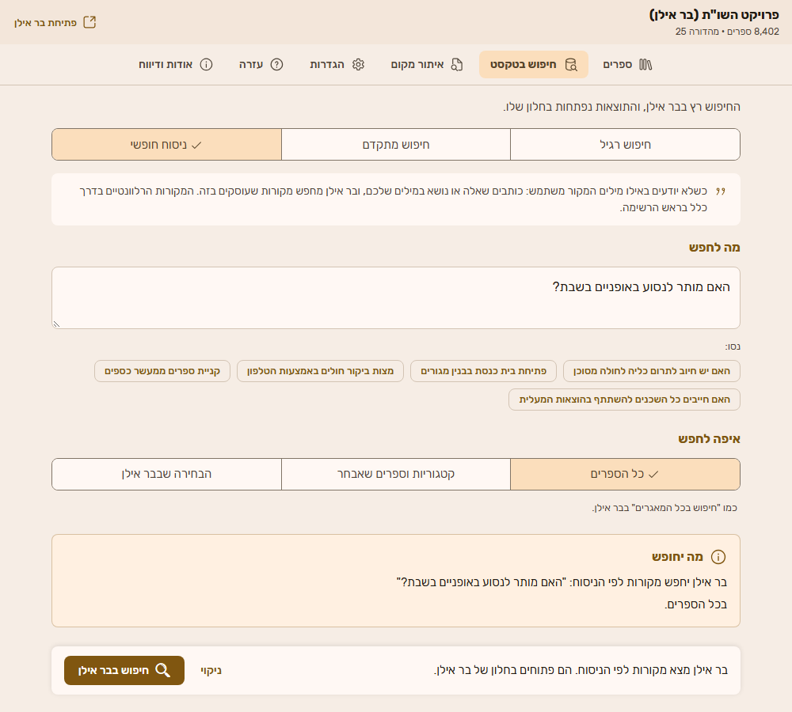

**דוגמאות** (מחלון החיפוש של בר אילן, וב"נסו:"):

- האם יש חיוב לתרום כליה לחולה מסוכן
- פתיחת בית כנסת בבנין מגורים
- מצות ביקור חולים באמצעות הטלפון
- קניית ספרים ממעשר כספים
- האם חייבים כל השכנים להשתתף בהוצאות המעלית

**כדאי לדעת:**

- **מתי להשתמש:** כשמחפשים נושא, ולא מילים מדויקות. כשיודעים את המילים, "חיפוש רגיל" או "חיפוש מתקדם" מדויקים יותר.
- **המקורות הרלוונטיים בדרך כלל בראש הרשימה.** בר אילן אינו מראה כמה מקורות מצא בניסוח חופשי, ולכן התשובה בתחתית הלשונית היא "בר אילן מצא מקורות לפי הניסוח".
- כותבים עד 300 תווים. ניקוד, אנגלית, ספרות וסימני חיפוש נמחקים.

#### איפה לחפש

בכל סוגי החיפוש:

- **כל הספרים:** כמו "חיפוש בכל המאגרים" בבר אילן.
- **קטגוריות וספרים שאבחר:** מסמנים ברשימה (נכנסים לקטגוריה בחץ שבצדה). מה שנבחר מופיע למעלה, ו-X מסיר אותו. הבחירה נשמרת גם בבר אילן, לחיפושים הבאים בו. האפשרות מופיעה אחרי שרשימת הספרים נקראה.
- **הבחירה שבבר אילן:** הספרים שכבר נבחרו בבר אילן, ב"המאגרים המשתתפים".

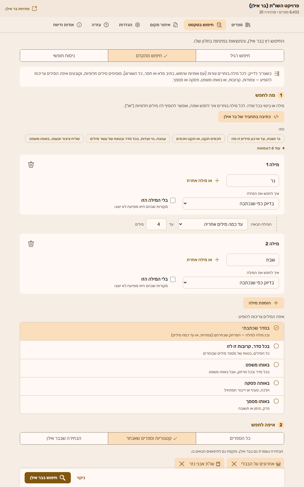

בחיפוש המתקדם יש גם **אפשרויות**: **כולל ראשי תיבות** ("צער בעלי חיים" ימצא גם "צעב"ח"), ו**לבחור צורות לפני התוצאות** (בר אילן פותח את "ניהול הצורות", ושם בוחרים אילו צורות של המילים ייכללו).

#### התשובה של בר אילן

בתחתית הלשונית מופיעה התשובה, והתוצאות פתוחות בחלון של בר אילן:

| התשובה | מה עושים |
|---|---|
| "בר אילן מצא 191 תוצאות" | התוצאות בחלון של בר אילן. |
| בר אילן שואל "האם ברצונך לחפש בכל המאגרים?" | במאגרים שנבחרו לא נמצא דבר. עונים בחלון של בר אילן. |
| "נמצאו מעל 32000 תוצאות" | החיפוש כללי מדי: מוסיפים מילה, בוחרים צורה מדויקת יותר, או מצמצמים את "איפה לחפש". |
| "שגיאה בהגדרת השאילתה" | ההסבר של בר אילן מוצג כמו שהוא. בתחביר שנכתב ביד — לבדוק את הסימנים. |

**החיפוש נשמר:** בפעם הבאה הלשונית נפתחת עם החיפוש האחרון. **"ניקוי"** מאפס את המילים, ומשאיר את סוג החיפוש, התחום והאפשרויות.

#### כל אפשרויות החיפוש של בר אילן, ואיפה הן בתוסף

| בבר אילן | בתוסף |
|---|---|
| **חיפוש קל**, וההגדרות שלו (ללא תוספות / עם תוספות: קידומות, מרחק של עד 2 מילים, כתיב מלא) | חיפוש רגיל ← "איך לחפש את המילים" |
| **חיפוש מתקדם**: מילים צמודות, מרחקים `[1:4]`, `[-1:1]`, חלופות `(א/ב)`, פיזור `10:` | חיפוש מתקדם: שדות, "או מילה אחרת", המרחק בין המילים, "בכל סדר, קרובות זו לזו" |
| מאפייני המילה: קידומות וסיומות דקדוקיות, כל אות, כתיב מלא/חסר, גרשיים, ערך, שורש, תרגום לארמית, שלילה, משפחה, חיפוש שמור | חיפוש מתקדם ← "איך לחפש את המילה" ו"בלי המילה הזו" |
| **חיפוש טבלאי**: טורים, מילים חלופיות בכל טור, מרחקים בין הטורים, בסדר או בכל סדר | חיפוש מתקדם: שדות, חלופות, מרחקים |
| חיפוש טבלאי ← טווח מילים / בתוך משפט / בתוך פסקה / בתוך מסמך | חיפוש מתקדם ← "איפה המילים צריכות להופיע" |
| חיפוש טבלאי ← **{{ביטוי}}** | ביטוי של כמה מילים בשדה, גם כחלופה |
| **חיפוש בניסוח חופשי** | ניסוח חופשי |
| חיפוש בכל המאגרים / המאגרים המשתתפים | "איפה לחפש" |
| כולל ראשי תיבות, הצג חלון ניהול הצורות | חיפוש מתקדם ← אפשרויות |
| כתיבת השאילתה ביד | "כתיבה בתחביר של בר אילן" |

**נשארו בבר אילן עצמו:** **חיפוש לפי ניקוד** (בחיפוש הטבלאי, הכפתור "ניקוד..."; לחוקרי לשון, בטקסטים מנוקדים כמו התנ"ך), ועריכת **משפחות**, **חיפושים שמורים** ו**שאילתות קודמות**. משפחה וחיפוש שמור שהגדרתם שם אפשר לחפש מהתוסף ("איך לחפש את המילה"). הכפתור **"פתיחת בר אילן"** בראש הלשונית מביא את בר אילן לחזית.

### איתור מקום

בלשונית **"איתור מקום"** כותבים שם ספר ומקום בו, ולוחצים **"פתיחה בבר אילן"** (או Enter). בר אילן נפתח ישר במקום הזה.

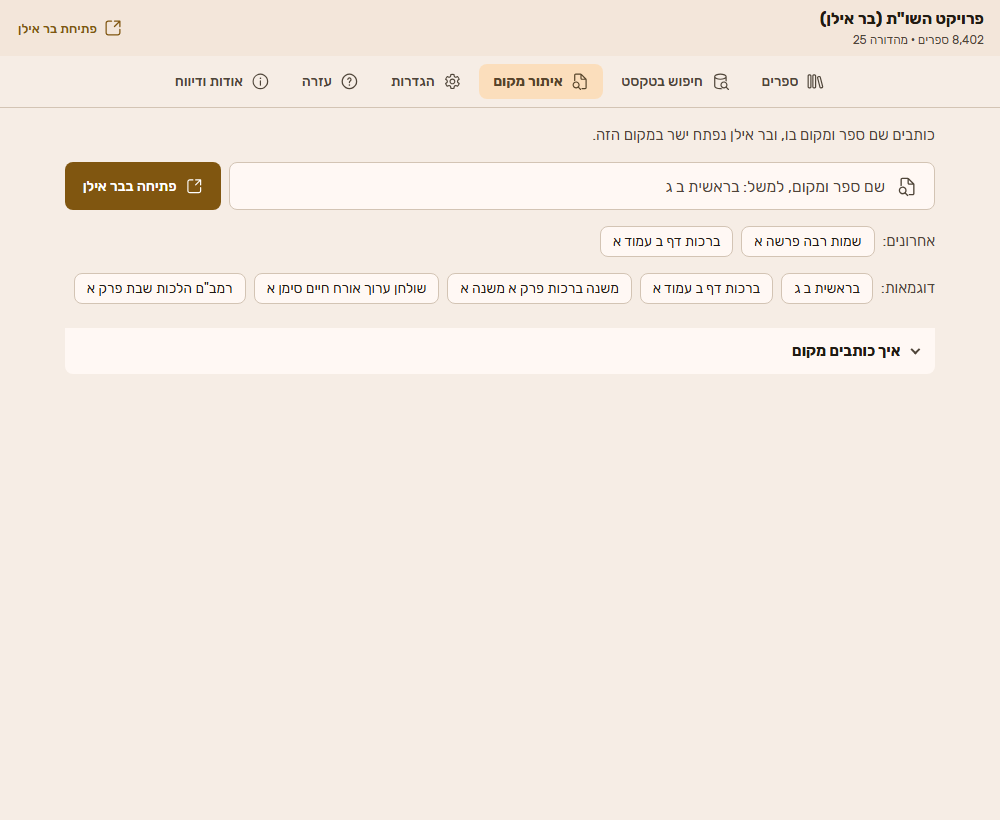

- **איך כותבים:** שם הספר כמו בבר אילן, בכתיב מלא, ואחריו המקום. למשל:
  - `בראשית ב ג` — הפסוק;
  - `ברכות דף ב עמוד א`;
  - `משנה ברכות פרק א משנה א`;
  - `שולחן ערוך אורח חיים סימן א`;
  - `רמב"ם הלכות שבת פרק א`.
- **כמה מקורות:** כשבר אילן מוצא כמה מקורות, למשל הגמרא, רש"י ותוספות על אותו דף, הם מוצגים ברשימה. לוחצים על המקור שרוצים לפתוח.
- **"אחרונים":** המקומות שנפתחו לאחרונה. לחיצה פותחת אותם שוב.
- **מתוך רשימת הספרים:** "פתיחה במקום מסוים" שליד כל ספר בלשונית "ספרים" ממלא כאן את שם הספר.
- **"בר אילן לא מצא את …":** בודקים את שם הספר (אפשר לחפש אותו בלשונית "ספרים") ואת הכתיב.

### ספרי בר אילן במסך הספרייה של אוצריא

1. במסך **הספרייה** של אוצריא, הקלידו בתיבה **"איתור ספר או מחבר"**, כרגיל.
2. בין התוצאות יופיעו גם ספרי בר אילן. **מתחת לשם הספר כתוב "בר אילן"** ואחריו מקומו בבר אילן.
3. לחיצה על ספר כזה **פותחת אותו בבר אילן**. אוצריא מציגה הודעה קטנה, למשל ""גינת ורדים" נפתח בבר אילן".

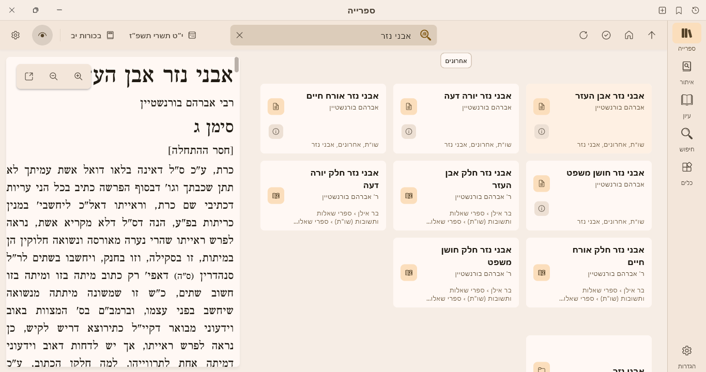

- הרשימה עוברת לאוצריא לבד, אחרי שהתוסף קרא אותה מבר אילן.
- צריך את ההרשאה "הוספת רכיבים לתוכנה".
- הפתיחה עובדת גם כשלשונית "בר אילן" סגורה: אוצריא פונה ישר לשירות.
- לא רוצים לראות את ספרי בר אילן שם? מכבים את המתג בלשונית "הגדרות".

---

## הגדרות התוסף

**איפה:** הלשונית **"הגדרות"** בתוסף.

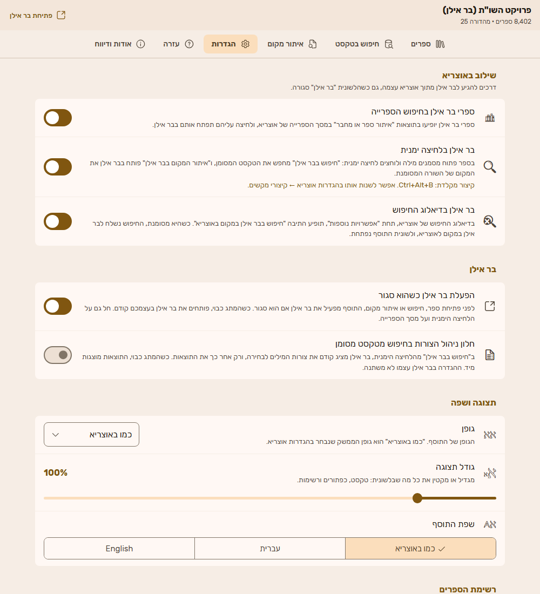

**שילוב באוצריא**
- **ספרי בר אילן בחיפוש הספרייה:** מציג את ספרי בר אילן בתיבה "איתור ספר או מחבר" של מסך הספרייה. כיבוי המתג מוחק את רשימת שמות הספרים מאוצריא, והדלקה שולחת אותה שוב.
- **בר אילן בלחיצה ימנית:** מוסיף (או מסיר) את "חיפוש בבר אילן" ואת "איתור המקום בבר אילן" מהתפריט של לחיצה ימנית בספר. קיצור המקלדת `Ctrl+Alt+B` עובד רק כשהמתג דלוק. אפשר לשנות את הקיצור באוצריא: הגדרות ← קיצורי מקשים ← "קיצורי תוספים".
- **בר אילן בדיאלוג החיפוש:** מציג (או מסתיר) את התיבה "חיפוש בבר אילן במקום באוצריא" בדיאלוג החיפוש של אוצריא, תחת "אפשרויות נוספות". התיבה עצמה כבויה עד שמסמנים אותה.
- **גם כשהלשונית סגורה:** החיפוש בלחיצה ימנית והפתיחה ממסך הספרייה עובדים גם כשהלשונית "בר אילן" סגורה, בלי שהתוסף רץ ברקע. "איתור המקום" ודיאלוג החיפוש פותחים את הלשונית, כדי שאפשר יהיה לבחור ולתקן בה.

**בר אילן**
- **הפעלת בר אילן כשהוא סגור** (דלוק כברירת מחדל): לפני פתיחה, חיפוש או איתור, התוסף מפעיל את בר אילן אם הוא סגור. כבוי: מופיעה הודעה שבר אילן סגור, ופותחים אותו בעצמכם. ההגדרה חלה גם על הלחיצה הימנית ועל מסך הספרייה. הכפתור "פתיחת בר אילן" פותח אותו תמיד.
- **סיכום התוצאות לפי מאגרים** (כבוי כברירת מחדל): אחרי חיפוש בבר אילן נפתח חלון קטן עם מספר התוצאות, ובו "הרחבה" לפירוט לפי מאגרים. כבוי: החלון נסגר מיד, ונשאר חלון התוצאות. ההגדרה חלה על כל החיפושים, גם מהלחיצה הימנית.
- **חלון ניהול הצורות בחיפוש מטקסט מסומן** (כבוי כברירת מחדל): ב"חיפוש בבר אילן" מהלחיצה הימנית, בר אילן מציג קודם את צורות המילים לבחירה. כבוי: התוצאות מוצגות מיד, גם כשבבר אילן עצמו התיבה "הצג חלון ניהול הצורות" מסומנת. ההגדרה שבבר אילן לא משתנה. בלשונית "חיפוש בטקסט" יש לכך תיבה משלה.

**תצוגה ושפה**
- **גופן:** תפריט נפתח, כמו בהגדרות אוצריא. "כמו באוצריא" (גופן הממשק שנבחר באוצריא, ברירת המחדל), או אחד מגופני אוצריא; כל גופן מוצג בגופן עצמו, עם דוגמה.
- **גודל תצוגה:** מחוון מ-90% עד 150%, בקפיצות של 5%. מגדיל או מקטין את כל מה שבלשונית: טקסט, כפתורים ורשימות. הגודל חל כשעוזבים את המחוון; במקלדת — בכל לחיצה על חץ.
- **שפת התוסף:** "כמו באוצריא" (ברירת המחדל), עברית, או English.

השינויים מיידיים.

**רשימת הספרים:** כמה ספרים יש, מתי נקראו, ממהדורה כמה, וכפתור **"קריאה מחדש"**.

**קיצורי דרך:** כפתור שיוצר **קיצור בשולחן העבודה** (וגם **בתפריט התחל**) שפותח את אוצריא ישר בלשונית בר אילן.

---

## עזרה ותמיכה בתוך התוסף

**איפה:** הלשונית **"עזרה"** בתוסף.

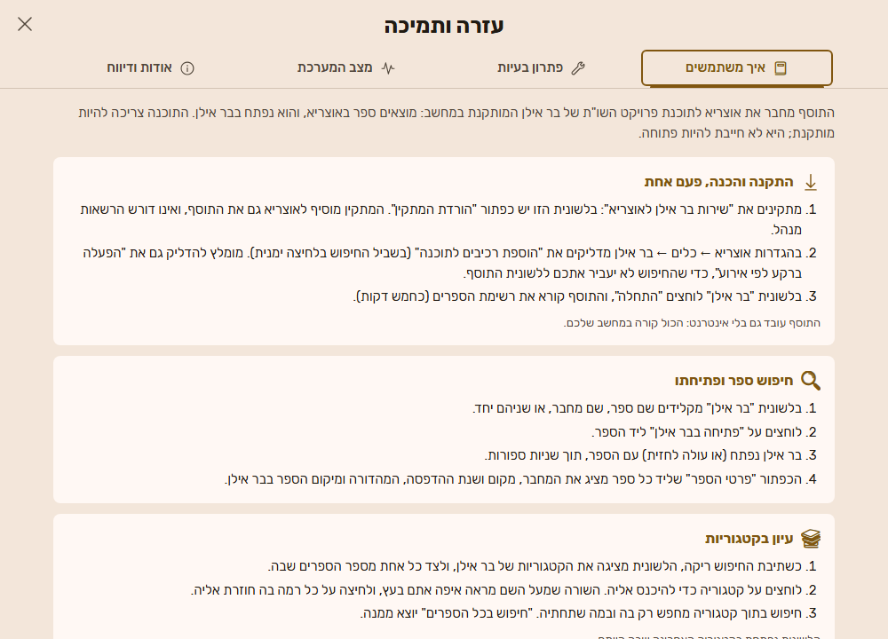

שלוש כרטיסיות:

### איך משתמשים

הדרכה קצרה, בתוך התוסף ובלי אינטרנט: התקנה והכנה, ספרים, עיון בקטגוריות, חיפוש בטקסט, איתור מקום, ספרי בר אילן במסך הספרייה, חיפוש טקסט מספר פתוח, קריאת רשימת הספרים והגדרות. בסוף יש קישור ל**מדריך המלא באתר** (המדריך הזה).

### פתרון בעיות

שאלות נפוצות. לוחצים על שאלה כדי לראות את התשובה.

### מצב המערכת

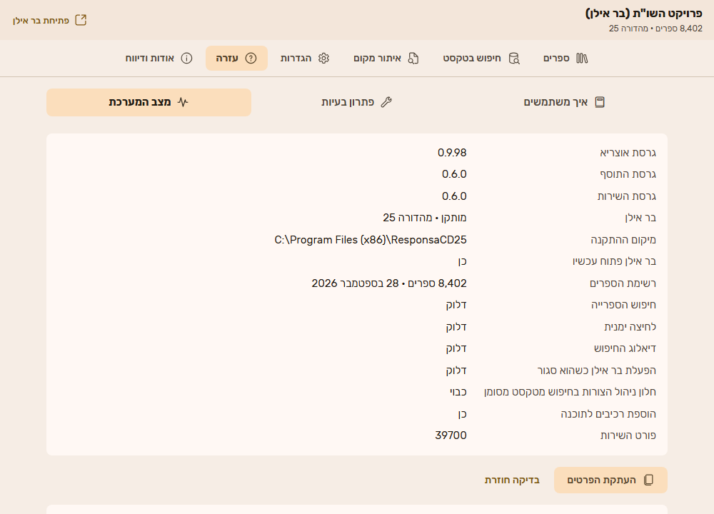

- **הפרטים:** גרסת אוצריא, גרסת התוסף והשירות, האם בר אילן מותקן ובאיזו מהדורה, איפה, האם הוא פתוח עכשיו, כמה ספרים ברשימה, ומה מצב ההרשאות.
- **"פעולות אחרונות":** מה התוסף עשה לאחרונה, מהחדש לישן. למשל: "נמצא השירות", "פתיחת קישור", או שגיאה. זה עוזר להבין מה קרה רגע לפני תקלה.
- **"העתקת הפרטים":** מעתיק את הפרטים ואת היומן המלא, להדבקה בפנייה לתמיכה. שם המשתמש שלכם ב-Windows מושמט מכל נתיב.
- **"בדיקה חוזרת":** בודק שוב את השירות ואת בר אילן.

---

## אודות ודיווח

**איפה:** הלשונית **"אודות ודיווח"** בתוסף. זו גם הדרך לפנות למפתח: דיווח מתוך התוסף, או ב-GitHub.

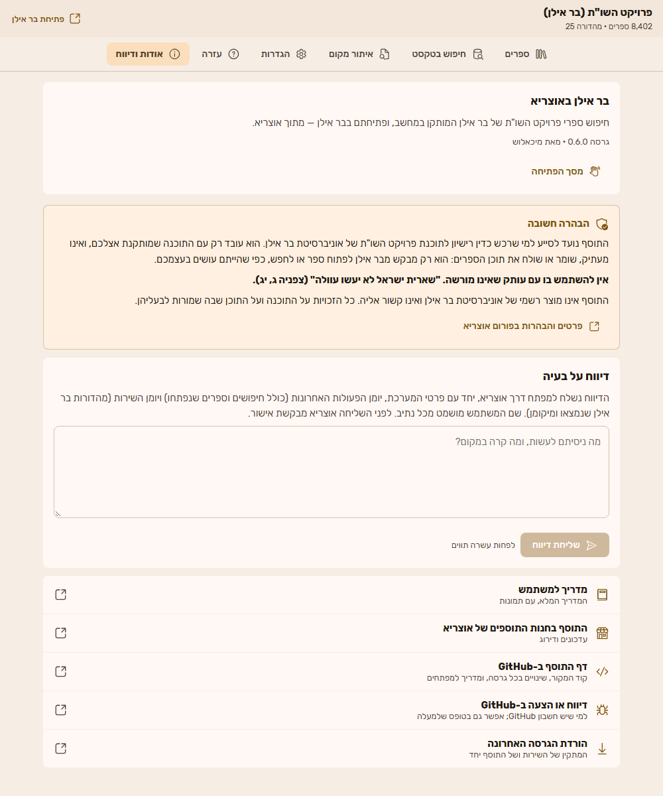

- **"מסך הפתיחה":** פותח שוב את מסך הפתיחה.
- **הבהרה חשובה:** אותה הבהרה על הרישיון שבמסך הפתיחה.
- **קישורים:** המדריך הזה, התוסף בחנות התוספים של אוצריא, דף התוסף ב-GitHub, דיווח או הצעה ב-GitHub, והורדת הגרסה האחרונה. **בלי אינטרנט** הקישורים לא נפתחים, ומוצגת הכתובת במקום.
- **"דיווח על בעיה":** כותבים מה ניסיתם לעשות ומה קרה (לפחות עשרה תווים), ולוחצים **"שליחת דיווח"**.
  - הדיווח עובר למפתח דרך אוצריא, יחד עם פרטי המערכת, יומן הפעולות האחרונות (כולל חיפושים וספרים שנפתחו) ויומן השירות (מהדורות בר אילן שנמצאו במחשב ומיקומן, ומה קרה בקריאת רשימת הספרים). כך אפשר למצוא את שורש התקלה בלי לבקש מכם פרטים נוספים.
  - **שם המשתמש מושמט** מכל נתיב.
  - אוצריא מבקשת אישור לפני השליחה.
  - **בלי אינטרנט** הדיווח נשמר, ויישלח כשיהיה חיבור.
  - **אם הדיווח לא נשלח**, ההודעה כוללת את הכתובת של דף הדיווחים ב-GitHub.

---

## בלי אינטרנט

**התוסף עובד בלי אינטרנט.** החיפוש, פרטי הספרים, הפתיחה בבר אילן והחיפוש בלחיצה ימנית קורים כולם במחשב שלכם.

מה כן צריך אינטרנט:
- **הורדת המתקין.** במחשב בלי אינטרנט בכלל: מורידים במחשב אחר את המתקין (<https://github.com/mmichaelush/otzaria-responsa-plugin/releases/latest/download/OtzariaResponsa-Setup.exe>) ומעבירים אותו בדיסק און קי. המתקין כולל את השירות ואת התוסף לאוצריא, ואין צורך בחנות התוספים.
- **הקישורים ב"אודות ודיווח".** בלי אינטרנט הם לא נפתחים, ומוצגת הכתובת. ההדרכה שבתוך התוסף ("איך משתמשים") זמינה תמיד.
- **שליחת דיווח.** הוא נשמר, ויישלח כשיהיה חיבור.

---

## מתי לקרוא את רשימת הספרים מחדש

**רק במקרים האלה:**
- התקנתם מהדורה חדשה של בר אילן;
- ספר מסוים לא נמצא או לא נפתח;
- מעל שורת החיפוש מופיע פס צבעוני עם משולש אזהרה, שממליץ לקרוא מחדש. אפשר ללחוץ ישר על "קריאה מחדש" שבתוכו.

**איך:** הלשונית **"הגדרות"** ← **"רשימת הספרים"** ← **"קריאה מחדש"**.
- זה לוקח כמה דקות, לפי מהירות המחשב (במחשב שבו נבדק התוסף: פחות משתי דקות).
- **החיפוש ממשיך לעבוד בזמן הזה**, על הרשימה הקיימת.
- **פתיחת ספרים חוזרת בסיום**, כי בזמן הקריאה בר אילן תפוס.

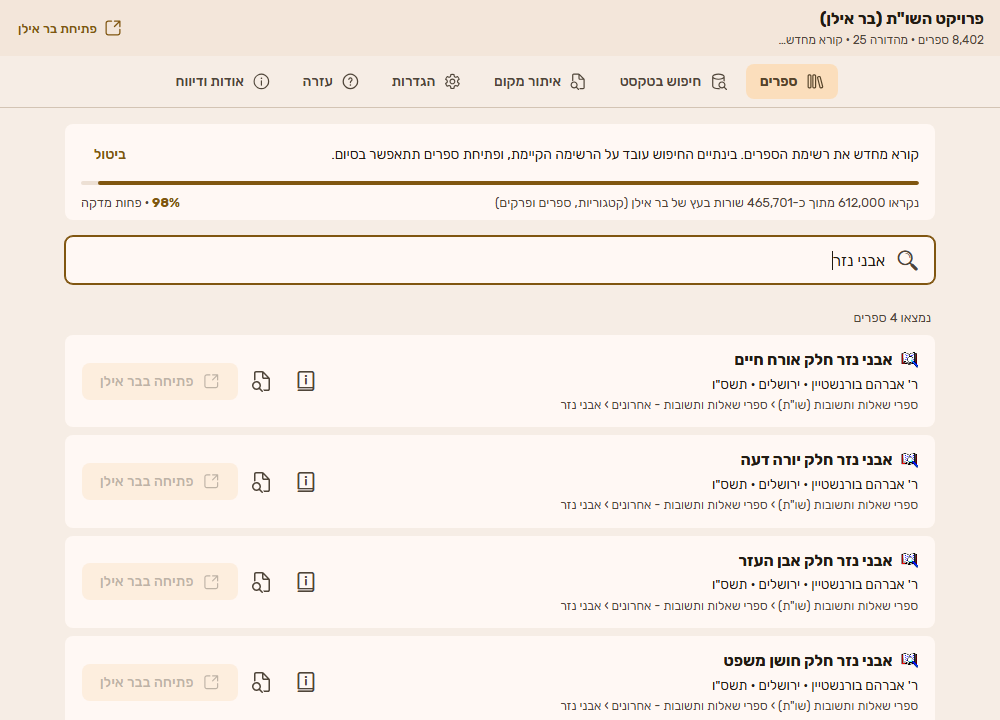

---

## פתרון בעיות

| מה רואים | מה זה אומר | מה עושים |
|---|---|---|
| **"צריך להתקין רכיב קטן, פעם אחת"** | השירות לא מותקן, או לא פועל כרגע | אם עוד לא התקנתם: "הורדת המתקין" והתקנה (ראו למעלה). אם כבר התקנתם: הפעילו מחדש את המחשב. המסך יתעדכן מעצמו. אין אינטרנט? הורידו את המתקין במחשב אחר |
| **"התוסף צריך הרשאה"** | ההרשאה "גישה לשירותים מקומיים" כבויה | באוצריא: הגדרות ← **כלים** ← "בר אילן" ← הדליקו "גישה לשירותים מקומיים". אחר כך "בדיקה חוזרת" |
| **"השירות לא מגיב כרגע"** | הרכיב פועל אבל לא עונה | "בדיקה חוזרת". אם זה חוזר, הפעילו מחדש את המחשב. אם גם זה לא עוזר: "העתקת הפרטים", ושלחו אותם (ראו "אודות ודיווח") |
| **"השירות לא מגיב כרגע"**, עם **"שירות בר אילן שבמחשב ישן"** | התוסף עודכן מחנות אוצריא, אבל השירות לא: הוא מתעדכן רק מהמתקין | "הורדת המתקין", והתקנה. אחר כך "בדיקה חוזרת" |
| **"שירות בר אילן שבמחשב (גרסה …) ישן מהתוסף"** (מעל החיפוש) | כמו בשורה הקודמת, אבל השירות עובד | כדאי להתקין את המתקין החדש: יש בו תיקונים |
| **"שירות בר אילן שבמחשב ישן ואינו מכיר את החיפוש הזה"** (ב"ניסוח חופשי") | השירות קודם לניסוח החופשי. שאר סוגי החיפוש עובדים | "הורדת הגרסה החדשה", והתקנה |
| **"צריך לעדכן את שירות בר אילן"** או **"צריך לעדכן את התוסף"** | גרסת השירות וגרסת התוסף לא מתאימות | "הורדת הגרסה החדשה" והתקנה. המתקין מעדכן את שניהם |
| **"בר אילן לא נמצא במחשב"** | תוכנת פרויקט השו"ת לא מותקנת | התקינו את בר אילן. המסך יתעדכן מעצמו |
| **"בר אילן לא מגיב כרגע. הקריאה ממתינה לו"** (בזמן קריאת הרשימה) | בר אילן עסוק לרגע | כלום. הקריאה ממשיכה מעצמה, עד שלוש דקות. אין צורך לבטל |
| **"בר אילן קרס בפתיחת "…""** (בזמן קריאת הרשימה) | תקלה בבר אילן עצמו, בספר מסוים | כלום. השירות מפעיל את בר אילן מחדש וממשיך. אם בר אילן קורס שוב באותו ספר, הספר לא נפתח עוד: הוא נשאר ברשימה ונפתח לפי שמו, בלי הפרקים שלו |
| **"קריאת רשימת הספרים לא הושלמה"** | משהו הפריע בזמן הקריאה | קראו את ההסבר במסך: הוא אומר אם בר אילן לא הגיב, אם החלון "עיון" נסגר, או אם בר אילן עצמו נסגר (קרס). סגרו את הספרים הפתוחים בבר אילן, אל תעבדו בו בזמן הקריאה, ולחצו "ניסיון נוסף". שום דבר לא נמחק. אם זה חוזר: "העתקת הפרטים", ושלחו אותם |
| **"אין גישה לבר אילן, כנראה כי הוא פועל כמנהל מערכת"** (בתוך המסך הקודם) | בר אילן נפתח עם "הפעל כמנהל" | סגרו את בר אילן, פתחו אותו רגיל (לחיצה כפולה על הסמל), ולחצו "ניסיון נוסף" |
| **"בר אילן הופעל אך לא עלה בתוך … שניות"** או **"בר אילן (…) אינו פעיל"** | בר אילן איטי לעלות | פתחו את בר אילן בעצמכם, חכו שייטען עד הסוף, ונסו שוב |
| **"תוכנה אחרת תופסת את החיבור של השירות"** | תוכנה אחרת במחשב משתמשת באותו חיבור (מספר פנימי במחשב, אין מה לשנות) | הפעילו מחדש את המחשב. אם זה חוזר, פנו לתמיכה |
| **"בבר אילן פתוחים כבר חלונות רבים"** | בר אילן מפסיק לפתוח חלונות אחרי כ-22 | סגרו בבר אילן כמה חלונות ישנים, ונסו שוב |
| **'בר אילן לא פתח את חלון "עיון"'** | חלון אחר פתוח בבר אילן ומחכה לתשובה | עברו לבר אילן, סגרו את החלון שפתוח בו (למשל הודעה), ונסו שוב |
| **"בר אילן לא הגיב בזמן"** או **"השירות לא הגיב בזמן"** | בר אילן עסוק או ממתין לתשובה | כנ"ל: עברו לבר אילן, סגרו חלון שמחכה, ונסו שוב |
| **"בטקסט שנבחר אין מילים בעברית"** | בחיפוש בבר אילן נבחרו רק מספרים, סימנים או אנגלית | סמנו מילה או משפט בעברית, ונסו שוב |
| **"בר אילן לא פתח את חלון החיפוש"** או **"בר אילן לא השיב על החיפוש בזמן"** | חלון אחר פתוח בבר אילן ומחכה לתשובה, או שבר אילן עסוק | עברו לבר אילן, סגרו את החלון שפתוח בו, ונסו שוב |
| **"בר אילן מחפש כרגע"** או **"ספר נפתח כרגע בבר אילן"** | פעולה קודמת עוד לא הסתיימה | חכו כמה שניות ונסו שוב |
| **בלחיצה ימנית: "שירות בר אילן אינו פועל"** | השירות לא ענה במחשב | פתחו את לשונית "בר אילן": היא בודקת מה חסר ומציעה מה לעשות. אחרי התקנה חדשה של השירות, פתיחה אחת של הלשונית מחברת אותו שוב |
| **אין "חיפוש בבר אילן" בתפריט של לחיצה ימנית** | המתג בלשונית "הגדרות" כבוי, לא סומן טקסט, או שלשונית "בר אילן" עוד לא נפתחה מאז ההתקנה | סמנו טקסט לפני הלחיצה הימנית, בדקו את המתג, ופתחו את לשונית "בר אילן" פעם אחת |
| **ספרי בר אילן לא מופיעים במסך הספרייה** | המתג כבוי, ההרשאה "הוספת רכיבים לתוכנה" כבויה, או שהרשימה עוד לא נקראה | הדליקו את המתג ואת ההרשאה, והקלידו לפחות שלוש אותיות |
| **'בר אילן לא זיהה את "…"'** | הספר לא קיים במהדורה המותקנת, או שהרשימה ישנה | לשונית "הגדרות" ← "קריאה מחדש", ונסו שוב |
| **'בר אילן לא מצא את "…"' באיתור מקום** | בר אילן לא זיהה את שם הספר או את המקום | כתבו את שם הספר כמו בבר אילן, בכתיב מלא, ואחריו את המקום: "בראשית ב ג", "ברכות דף ב עמוד א". את שם הספר אפשר לבדוק בלשונית "ספרים" |
| **'בר אילן פתח ספר אחר במקום "…", והפתיחה בוטלה'** | התוסף זיהה שנפתח ספר לא נכון וסגר אותו | זה מכוון, כדי לא להציג ספר שגוי. נסו ספר אחר מאותה סדרה, או בנייה מחדש |
| **"רשימת התוצאות בבר אילן לא התנקתה"** | תקלה רגעית בבר אילן | נסו שוב. זה נדיר |
| **פס צבעוני: "הרשימה נקראה מהתקנה אחרת"** או **"נקראה בגרסה קודמת של התוסף"** | הרשימה ישנה | לחצו "קריאה מחדש" שבתוך הפס |
| **פס צבעוני: "קריאת הרשימה מחדש לא הושלמה"** | ניסיון קודם לקרוא מחדש נכשל | הרשימה הקודמת עדיין עובדת. אפשר לנסות שוב ב"קריאה מחדש" |
| **"לא ניתן לפתוח את הדפדפן. הכתובת: …"** | ההרשאה "פתיחת קישורים בדפדפן" כבויה | הדליקו אותה בהגדרות ← כלים, או העתיקו את הכתובת לדפדפן |
| **"הדיווח לא נשלח"** | אוצריא לא הצליחה לשלוח את הדיווח | נסו שוב מאוחר יותר, או דווחו ב-GitHub, בכתובת שבהודעה |
| **"אין כרגע חיבור לאינטרנט, ולכן הדף לא ייפתח"** | אין אינטרנט במחשב | זה לא משפיע על התוסף. ההדרכה זמינה ב"איך משתמשים", ואת הכתובת אפשר לפתוח במחשב אחר |
| **במסך השגיאה כתוב "קוד לתמיכה: …"** | שם קצר של התקלה, בשביל מי שעוזר לכם | ציטטו אותו בפנייה לתמיכה, יחד עם "העתקת הפרטים" |
| **במתקין: "לא נמצאה אוצריא במחשב"** | אוצריא לא מותקנת | התקינו את אוצריא, ואז לחצו לחיצה כפולה על הקובץ שמוצג בהודעה |
| **הספר נפתח, אבל החלון לא הופיע** | בר אילן נפתח מאחורי חלונות אחרים | לחצו על סמל בר אילן בשורת המשימות (הפס התחתון של המסך) |

### עדיין לא עובד?

1. **הפעילו מחדש את המחשב.** זה פותר את רוב הבעיות.
2. **שלחו דיווח מתוך התוסף:** הלשונית "אודות ודיווח" ← "דיווח על בעיה".
3. **או פתחו דיווח ב-GitHub**, ב-[Issues של הפרויקט](https://github.com/mmichaelush/otzaria-responsa-plugin/issues). צרפו:
   - מה ניסיתם לעשות ומה ראיתם, ואת **"קוד לתמיכה"** אם הופיע;
   - את **פרטי המערכת ויומן הפעולות**: הלשונית "עזרה" ← "מצב המערכת" ← "העתקת הפרטים", והדבקה בפנייה;
   - **את קובץ היומן.** כדי למצוא אותו:
     1. לחצו יחד על מקש **Windows** ועל **R**.
     2. בחלון שנפתח הדביקו `%LOCALAPPDATA%\OtzariaResponsa` ולחצו **אישור**.
     3. צרפו את הקובץ **helper**. ייתכן שהסיומת `.log` לא תוצג.

---

## עדכון והסרה

**עדכון:** מורידים את המתקין החדש ומתקינים. **רשימת הספרים נשמרת**, ואין צורך לקרוא אותה מחדש.

**הסרה:**
- **Windows 11:** הגדרות ← אפליקציות ← אפליקציות מותקנות ← ליד "שירות בר אילן לאוצריא" לחצו על שלוש הנקודות ← הסרת התקנה.
- **Windows 10:** הגדרות ← אפליקציות ← לחצו על "שירות בר אילן לאוצריא" ← הסר.

בתחילת ההסרה בוחרים מה להסיר:

| אפשרות | מה מוסר | מה נשאר |
|---|---|---|
| **הסרה לצורך עדכון או התקנה מחדש** | השירות | רשימת הספרים, התוסף באוצריא וההגדרות שלו. אחרי ההתקנה אין צורך לקרוא את הרשימה שוב |
| **הסרה רגילה** (מומלץ, ברירת המחדל) | השירות, רשימת הספרים וקובצי היומן (התיקייה `%LOCALAPPDATA%\OtzariaResponsa`) | התוסף באוצריא וההגדרות שלו |
| **הסרה מלאה** | הכול, כולל התוסף באוצריא וההגדרות שלו | כלום |

- **בהסרה מלאה** התוסף נמחק מאוצריא ישירות, עם ההגדרות שלו, כמו "מחק" בהגדרות ← **כלים**. **אוצריא צריכה להיות סגורה:** אם היא פתוחה, ההסרה מבקשת לסגור אותה ולחזור ל"אישור". גם אוצריא ניידת. אם ההסרה לא מוצאת איפה אוצריא שומרת את התוסף, היא פותחת את אוצריא בהגדרות ← כלים, ושם מוחקים את **"בר אילן"** ביד.
- **בסוף** מוצג סיכום של מה הוסר ומה נשאר.
- **התוסף בלבד:** מסירים אותו באוצריא, בהגדרות ← **כלים**. בלי השירות הוא מציג "צריך להתקין רכיב קטן".
- **הסרה מסקריפט:** `unins000.exe /VERYSILENT /MODE=update|regular|full` (הקובץ בתיקייה `%LOCALAPPDATA%\Programs\OtzariaResponsa`). הסרה שקטה בלי `/MODE` היא "לצורך עדכון", כדי שלא תמחק נתונים. בהסרה שקטה ב-`full` התוסף נמחק מאוצריא רק אם היא סגורה.

---

## שאלות נפוצות

**האם צריך אינטרנט?**
לא. הכול קורה במחשב שלכם, וגם ההתקנה אינה צריכה אינטרנט: את המתקין אפשר להוריד במחשב אחר ולהעביר בדיסק און קי, והוא כולל גם את התוסף. חיבור צריך רק כדי לפתוח קישורים ולשלוח דיווח, ודיווח בלי חיבור נשמר ונשלח אחר כך (ראו "בלי אינטרנט").

**מה הסמל של התוסף?**
ספר פתוח עם זכוכית מגדלת. כך הוא מופיע בסרגל הכלים של אוצריא, בחנות התוספים ובמתקין.

**האם התוסף רץ ברקע?**
לא. הוא רץ רק כשהלשונית שלו פתוחה. בלחיצה ימנית על "חיפוש בבר אילן", בקיצור `Ctrl+Alt+B` ובבחירת ספר של בר אילן בספרייה, אוצריא פונה ישר לשירות, בלי להעיר את התוסף. "איתור המקום בבר אילן", התיבה בדיאלוג החיפוש והקיצורים `Ctrl+Alt+R`/`T`/`L` פותחים את הלשונית. רשימת הספרים לספרייה שמורה אצל אוצריא, ולכן היא מופיעה גם כשהתוסף סגור. מה שפועל תמיד הוא "שירות בר אילן לאוצריא" (ראו בהמשך): תהליך קטן, כ-16MB, שממתין לבקשות.

**איך פונים למפתח?**
מתוך התוסף: הלשונית "אודות ודיווח" ← "דיווח על בעיה". למי שיש חשבון GitHub: ב-[Issues של הפרויקט](https://github.com/mmichaelush/otzaria-responsa-plugin/issues).

**האם התוסף משנה משהו בבר אילן?**
לא. הוא רק קורא את רשימת הספרים ופותח ספרים, בדיוק כמו שמשתמש היה עושה.

**למה בר אילן נפתח לבד בזמן ההכנה?**
רשימת הספרים נמצאת רק בתוך התוכנה, ולכן התוסף צריך אותה פתוחה כדי לקרוא אותה. אחרי ההכנה, בר אילן נפתח רק כשמבקשים לפתוח ספר.

**יש לי שתי מהדורות של בר אילן. מה קורה?**
התוסף עובד עם המהדורה שממנה נקראה הרשימה. אם תעברו למהדורה אחרת, תופיע המלצה לקרוא את הרשימה מחדש.

**במחשב יש כמה משתמשי Windows. זה עובד?**
כן. לכל משתמש יש שירות משלו, וכל אחד רואה ופותח ספרים רק על המסך שלו.

**מה זה "שירות בר אילן לאוצריא" שמופיע ברשימת האפליקציות?**
זה הרכיב שהמתקין מתקין.
- הוא רץ ברקע ומדבר עם בר אילן בשביל אוצריא.
- הוא קטן, ולא צורך משאבים כשלא משתמשים בו.
- הוא נפתח לבד בכל כניסה ל-Windows. אם כיביתם אותו, הדליקו אותו שוב: מנהל המשימות (Ctrl+Shift+Esc) ← **אפליקציות הפעלה** ← `responsa_helper` ← **הפעל**.
